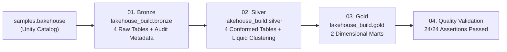

# Lakehouse Build

> End-to-end **Databricks Lakehouse** implementation based on the **Databricks Lakehouse Build** track, covering the full methodology lifecycle (**Assessment**, **Preparation**, and **Execution**) on **Databricks Free Edition**.

---

## 1. Overview

This repository implements a governed **Medallion Architecture** (`Bronze` -> `Silver` -> `Gold`) using the `samples.bakehouse` dataset in Unity Catalog. Every architectural choice, schema transformation, and quality gate is empirically grounded and documented across the three official modules of the **Databricks Lakehouse Build** methodology:

1. **Assessment** — Use case scoping, empirical source profiling, and governance design.
2. **Preparation** — Environment readiness, Unity Catalog schema setup, shared utilities, and Medallion patterns.
3. **Execution** — Bronze ingestion, Silver curation, Gold dimensional marts, automated quality validation, and Databricks Workflow orchestration.

---

## 2. Pipeline Architecture



All four stages are orchestrated sequentially by the Databricks Workflow Job **`[Lakehouse Build] Medallion Master Pipeline`** (Job ID: `1062809544312001`), defined in [lakehouse_master_pipeline_job.json](03_execution/lakehouse_master_pipeline_job.json), completing in **1m 45s** on serverless compute.

---

## 3. Implementation Status

All three modules of the **Databricks Lakehouse Build** track are completed and empirically validated:

| Module / Stage | Status | Key Deliverables & Highlights | Artifacts |
| :--- | :--- | :--- | :--- |
| **1. Assessment** | Completed | Use case charter, empirical profiling of `samples.bakehouse`, governance & design decisions. | [use_case_charter.md](01_assessment/01_use_case_definition_and_scope/use_case_charter.md), [source_workload_profiling_report.md](01_assessment/02_workload_and_source_profiling/source_workload_profiling_report.md), [governance_and_design_decisions.md](01_assessment/03_governance_readiness_and_design_decisions/governance_and_design_decisions.md) |
| **2. Preparation** | Completed | Catalog/schema readiness, shared helpers ([common_functions.py](notebooks/includes/common_functions.py), [configuration.py](notebooks/includes/configuration.py)), and Medallion standards. | [01_environment_and_catalog_readiness.md](02_preparation/01_environment_and_catalog_readiness.md), [02_ingestion_and_transformation_patterns.md](02_preparation/02_ingestion_and_transformation_patterns.md) |
| **3.1 Bronze Layer** | Completed | Ingested 4 raw tables into `lakehouse_build.bronze` with audit metadata and 100% row reconciliation. | [README.md](03_execution/01_bronze/README.md), [ingest_bronze.py](03_execution/01_bronze/ingest_bronze.py) |
| **3.2 Silver Layer** | Completed | Conformed 4 tables into `lakehouse_build.silver`; dropped `cardNumber`, derived `transaction_date`, resolved 21 orphaned franchises (`supplier_key = -1`), enabled Liquid Clustering. | [README.md](03_execution/02_silver/README.md), [curate_silver.py](03_execution/02_silver/curate_silver.py) |
| **3.3 Gold Layer** | Completed | Built 2 dimensional marts in `lakehouse_build.gold`; standardized on `total_sales_revenue_units`, Liquid Clustered on `(sales_date, franchise_id)`, 100% metric reconciliation (66,471 units). | [README.md](03_execution/03_gold/README.md), [build_gold.py](03_execution/03_gold/build_gold.py) |
| **3.4 Validation** | Completed | Automated audit suite validating **24/24 quality assertions** (completeness, uniqueness, referential integrity, PCI compliance, volumetric parity). | [README.md](03_execution/04_testing_and_validation/README.md), [validate_lakehouse.py](03_execution/04_testing_and_validation/validate_lakehouse.py) |
| **3.5 Orchestration** | Completed | 4 interactive notebooks deployed to Databricks Workspace and orchestrated via Databricks Workflows. | [01_bronze_ingestion.py](notebooks/01_bronze_ingestion.py), [02_silver_curation.py](notebooks/02_silver_curation.py), [03_gold_marts.py](notebooks/03_gold_marts.py), [04_quality_validation.py](notebooks/04_quality_validation.py) |

---

## 4. Tools & Environment

| Tool / Technology | Role in Project | Classification |
| :--- | :--- | :--- |
| **Databricks Lakehouse Build** | Phased methodology guiding Assessment, Preparation, and Execution. | Reference Track |
| **Databricks Free Edition** | Managed serverless compute and workspace for exploration and execution. | Project Environment |
| **Unity Catalog (`samples.bakehouse`)** | Governed data catalog and source dataset. | Data & Governance |
| **Delta Lake** | Storage format providing ACID transactions, time travel, schema enforcement, and Liquid Clustering. | Architectural Standard |
| **Apache Spark / PySpark** | Distributed engine for profiling, Medallion transformations, and validation. | Processing Engine |

---

## 5. Core Operating Principles

- **Phased Execution:** Follow Assessment -> Preparation -> Execution in strict sequence before building transformations.
- **Inspect Before Modifying:** Profile existing schemas, catalog metadata, and sample records prior to modeling.
- **Empirical Grounding:** Never invent or assume schemas, keys, relationships, or business rules—every decision is backed by data inspection.
- **Document All Decisions:** Record architectural choices, trade-offs, and model definitions under `01_assessment/` and `references/`.
- **Validate Results:** Enforce explicit quality gates (row counts, uniqueness, null ratios, referential integrity, and metric parity).
- **Environment Safety:** Built for **Databricks Free Edition** using `samples.bakehouse` with no synthetic data or destructive external operations.

---

## 6. Repository Structure

```text
lakehouse-build/
├── README.md                                                 # Project overview, architecture, and status
├── .agents/
│   └── skills/                                               # Operational methodology & engineering skills
│       ├── lakehouse_assessment/SKILL.md
│       ├── source_profiling/SKILL.md
│       ├── lakehouse_design/SKILL.md
│       ├── pyspark_delta/SKILL.md
│       └── data_quality_validation/SKILL.md
├── 01_assessment/                                            # Module 1: Assessment (Confirmed Sub-Stages)
│   ├── 01_use_case_definition_and_scope/
│   ├── 02_workload_and_source_profiling/
│   └── 03_governance_readiness_and_design_decisions/
├── 02_preparation/                                           # Module 2: Preparation
│   ├── 01_environment_and_catalog_readiness.md
│   └── 02_ingestion_and_transformation_patterns.md
├── 03_execution/                                             # Module 3: Execution
│   ├── 01_bronze/
│   ├── 02_silver/
│   ├── 03_gold/
│   ├── 04_testing_and_validation/
│   └── lakehouse_master_pipeline_job.json
├── notebooks/                                                # Databricks Workflow notebooks & shared includes
│   ├── 01_bronze_ingestion.py
│   ├── 02_silver_curation.py
│   ├── 03_gold_marts.py
│   ├── 04_quality_validation.py
│   └── includes/
│       ├── common_functions.py
│       └── configuration.py
└── references/
    ├── lakehouse_build_notes.md
    └── presentation_guide.md
```

> **Note on Methodology Sub-Stages:**
> The three sub-stages under `01_assessment/` are confirmed official sub-stages of the **Databricks Lakehouse Build** methodology. The folders under `02_preparation/` and `03_execution/` represent functional working directories for this implementation.
