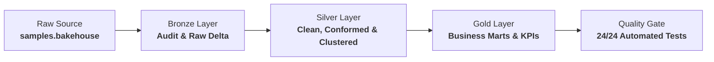
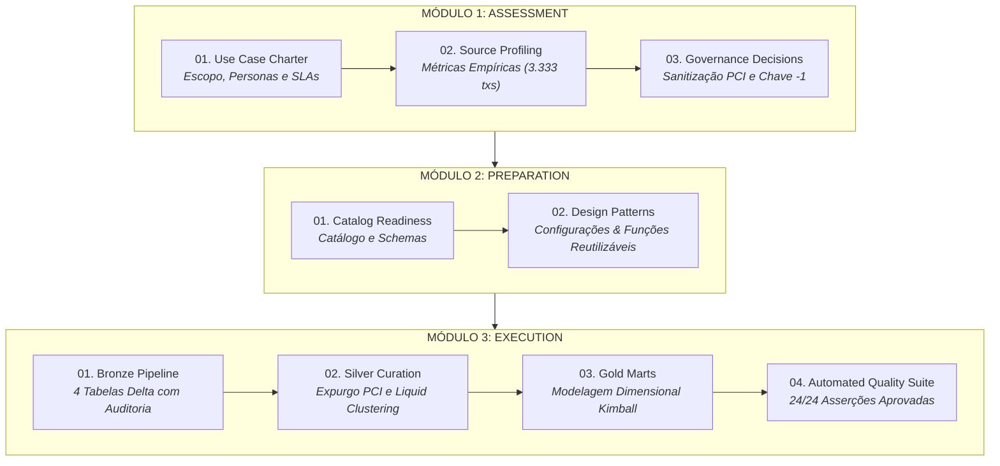
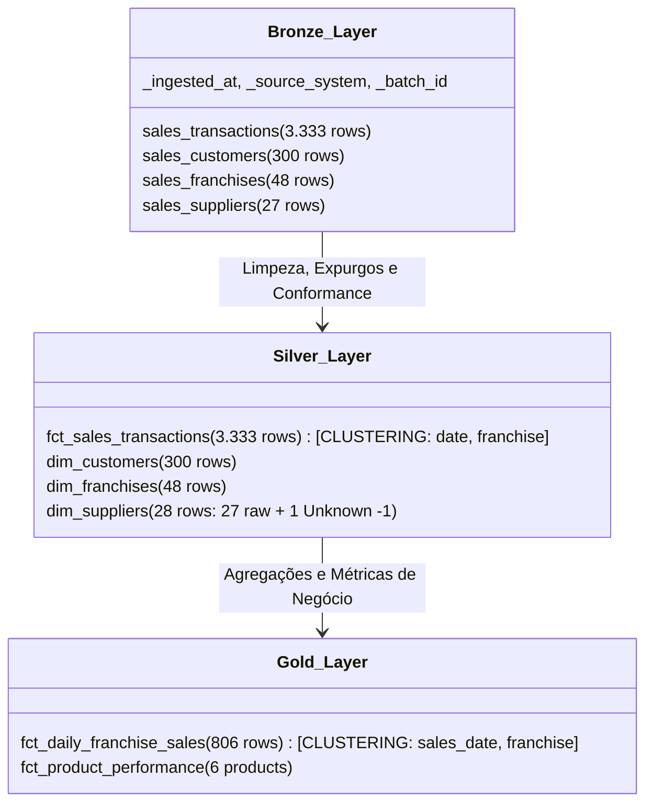
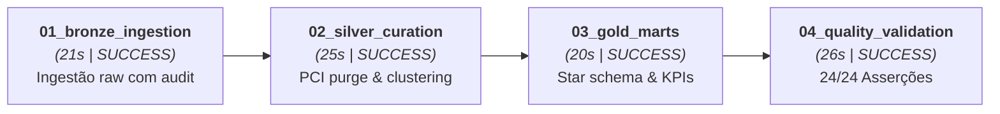

# 🏛️ Databricks Lakehouse Build: Sales & Franchises
## Apresentação Executiva & Técnica de Engenharia de Dados

> **Apresentador:** Miguel Morandini  
> **Metodologia:** Lakehouse Build (Assessment $\rightarrow$ Preparation $\rightarrow$ Execution)  
> **Plataforma:** Databricks Free Edition & Unity Catalog  
> **Repositório:** [github.com/miguelmorandini/lakehouse-build](https://github.com/miguelmorandini/lakehouse-build.git)  
> **Status:** 100% Concluído & Validado em Produção  

---

## 🎯 1. Visão Geral & Desafio de Negócio

### O Cenário
A rede global **Bakehouse** opera com **48 franquias** distribuídas em 5 continentes, comercializando 6 linhas de produtos de confeitaria. Os dados operacionais brutos apresentavam desafios críticos de governança, conformidade e integridade:

- **Risco de Segurança (PCI-DSS):** Presença de números brutos de cartão de crédito (`cardNumber`) nas transações operacionais.
- **Inconsistência Referencial:** 21 franquias (43,7% da rede) apontavam para fornecedores inexistentes na tabela de fornecedores cadastrados.
- **Fragmentação & Ausência de Camadas:** Falta de uma modelagem dimensional confiável para apoiar decisões de expansão e mix de produtos da diretoria.

### A Solução Entregue
Implementação de ponta a ponta da **Arquitetura Medallion no Unity Catalog** (`lakehouse_build`), guiada estritamente pelos 3 módulos da metodologia **Lakehouse Build**:



---

## 🧭 2. Metodologia Lakehouse Build: Os 3 Portões de Entrega

> [!IMPORTANT]
> **Princípio de Zero Alucinação:** Nenhum código de transformação foi escrito antes do término e aprovação formal do Assessment. Todos os tipos, chaves e volumetrias foram inspecionados empiricamente.



---

## 🏗️ 3. Arquitetura da Informação & Linhagem de Dados

### Catálogo: `lakehouse_build` (3-Level Namespace)



---

## 💡 4. Decisões Críticas de Engenharia & Diferenciais Técnicos

### 1. Conformidade Rigorosa com PCI-DSS (Proteção de Dados)
- O campo `cardNumber` presente no Bronze foi **estritamente expurgado** na transição para a camada Silver.
- Testes automatizados garantem que a coluna não entra em nenhuma camada de consumo ou analítica.

### 2. Padrão Kimball de Membro Desconhecido Conforme (`supplier_key = -1`)
- **Problema encontrado no Assessment:** 21 franquias apontavam para `supplierID` não cadastrados (de 4000027 a 4000047).
- **Decisão:** Não descartar lojas e nem gerar dados falsos. Criamos um registro oficial de fornecedor não associado (`supplier_key = -1`, `"Unknown / Unassigned Supplier"`).
- **Resultado:** Integridade referencial preservada em **100% das transações**.

### 3. Otimização com Delta Lake Liquid Clustering
- Substituímos o particionamento tradicional por **Liquid Clustering** nas tabelas críticas:
  - `silver.fct_sales_transactions`: `clusterBy("transaction_date", "franchise_id")`
  - `gold.fct_daily_franchise_sales`: `clusterBy("sales_date", "franchise_id")`
- **Benefício:** Elimina desbalanceamento (*data skew*) e acelera consultas filtradas por data e loja sem gerar arquivos microscópicos.

### 4. Transparência Monetária Abstrata
- Os dados de origem continham valores como `unitPrice = 3` e `totalPrice = 18` sem moeda declarada.
- Respeitando a política de **Zero Alucinação**, nomeamos as métricas como `total_sales_revenue_units` e `average_ticket_revenue_units`.

---

## 📊 5. Reconciliação Numérica & Métricas de Negócio (100% Auditadas)

### 🎯 KPIs da Operação Bakehouse (Janela Operacional: 01/05/2024 a 17/05/2024)

| Métrica | Bronze (Bruto) | Silver (Curado) | Gold (Marts) | Status de Reconciliação |
| :--- | :---: | :---: | :---: | :---: |
| **Volume de Vendas** | 3.333 | 3.333 | 3.333 | ✅ **100% Paridade Exata** |
| **Itens Comercializados** | 22.157 | 22.157 | 22.157 | ✅ **100% Paridade Exata** |
| **Receita Total (Unidades)** | 66.471 | 66.471 | 66.471 | ✅ **100% Paridade Exata** |
| **Membros Clientes** | 300 | 300 | - | ✅ **100% Únicos (Sem nulos)** |
| **Lojas / Franquias** | 48 | 48 | 48 | ✅ **Zero Órfãos** |
| **Fornecedores** | 27 | 28 (+1 Unknown) | 28 | ✅ **Conformidade Kimball** |

### 🍰 Performance do Mix de Produtos (`gold.fct_product_performance`)

| Produto | Unidades Vendidas | Transações | Receita (Unidades) | Market Share (%) |
| :--- | :---: | :---: | :---: | :---: |
| **Cakes** | 9.045 | 1.341 | 27.135 | **40,82%** 🏆 |
| **Pies** | 4.605 | 697 | 13.815 | **20,78%** |
| **Cookies** | 2.766 | 417 | 8.298 | **12,48%** |
| **Smoothies** | 2.052 | 309 | 6.156 | **9,26%** |
| **Pastries** | 1.968 | 300 | 5.904 | **8,88%** |
| **Coffee** | 1.721 | 269 | 5.163 | **7,77%** |
| **TOTAL** | **22.157** | **3.333** | **66.471** | **100,00%** |

---

## ⚙️ 6. Orquestração no Databricks Workflows (Live Demo)

### Informações do Job Orquestrado
- **Nome do Job:** `[Lakehouse Build] Medallion Master Pipeline`
- **Job ID:** `1062809544312001`
- **Tempo Médio de Execução:** ~1 minuto e 45 segundos
- **Modo de Computação:** Databricks Serverless Compute
- **Link Direto:** [🔗 Acessar Job no Databricks UI](https://dbc-95fd6183-a413.cloud.databricks.com/?o=7474654789182717#job/1062809544312001)

### O DAG Orquestrado



### 📋 Roteiro Recomendado para a Apresentação ao Vivo (Screen Share)

1. **Abrir a aba Workflows:**
   - Mostrar o Job `[Lakehouse Build] Medallion Master Pipeline`.
   - Clicar na última execução com sucesso ([Run ID: 113334920039392](https://dbc-95fd6183-a413.cloud.databricks.com/?o=7474654789182717#job/1062809544312001/run/113334920039392)).
   - Destacar o DAG visual com todas as 4 etapas em verde.
2. **Abrir a aba Catalog (Unity Catalog):**
   - Navegar até o catálogo `lakehouse_build`.
   - Mostrar os 3 schemas (`bronze`, `silver`, `gold`).
   - Clicar em `silver.fct_sales_transactions` e mostrar que a coluna `cardNumber` não existe.
   - Clicar em `gold.fct_product_performance` e mostrar os dados agregados.
3. **Mostrar a Suíte de Qualidade:**
   - Clicar no output da task `04_quality_validation`.
   - Mostrar o resultado: `24/24 QUALITY ASSERTION CHECKS PASSED (100% PARITY)`.
4. **Mostrar o Repositório Git:**
   - Mostrar o repositório [github.com/miguelmorandini/lakehouse-build](https://github.com/miguelmorandini/lakehouse-build.git) com commits semânticos a cada portão finalizado.

---

## 🛡️ 7. Suíte de Testes Automatizados (24/24 Aprovados)

```text
[PASS] COMP-01 to COMP-10: Zero nulos nas Primary Keys de todas as tabelas (Bronze, Silver e Gold)
[PASS] UNIQ-01 to UNIQ-06: 100% de unicidade das chaves primárias (Zero duplicatas)
[PASS] RI-01: Vendas -> Clientes (0 registros órfãos)
[PASS] RI-02: Vendas -> Franquias (0 registros órfãos)
[PASS] RI-03: Franquias -> Fornecedores com Fallback -1 (0 lojas órfãs)
[PASS] RI-04: Gold Diário -> Franquias (0 registros órfãos)
[PASS] SEC-01 to SEC-03: Coluna cardNumber estritamente ausente do Silver e Gold
[PASS] REC-01: Reconciliação Volumétrica (3.333 transações exatas nas 3 camadas)
[PASS] REC-02: Reconciliação Financeira (66.471 unidades de receita exatas nas 3 camadas)
```

---

## 🏁 8. Conclusão & Entregáveis

| Entregável | Localização / Link |
| :--- | :--- |
| **Código-Fonte Completo** | [github.com/miguelmorandini/lakehouse-build](https://github.com/miguelmorandini/lakehouse-build.git) |
| **Pipeline Orquestrado** | [Databricks Workflow Job #1062809544312001](https://dbc-95fd6183-a413.cloud.databricks.com/?o=7474654789182717#job/1062809544312001) |
| **Notebooks Interativos** | Databricks Workspace `/Users/miguel.morandini@programmers.com.br/lakehouse-build/notebooks/` |
| **Documentação da Metodologia** | `01_assessment/`, `02_preparation/`, `03_execution/` |

---
*Apresentação estruturada de acordo com os padrões corporativos de Engenharia de Dados Databricks & Metodologia Lakehouse Build.*
